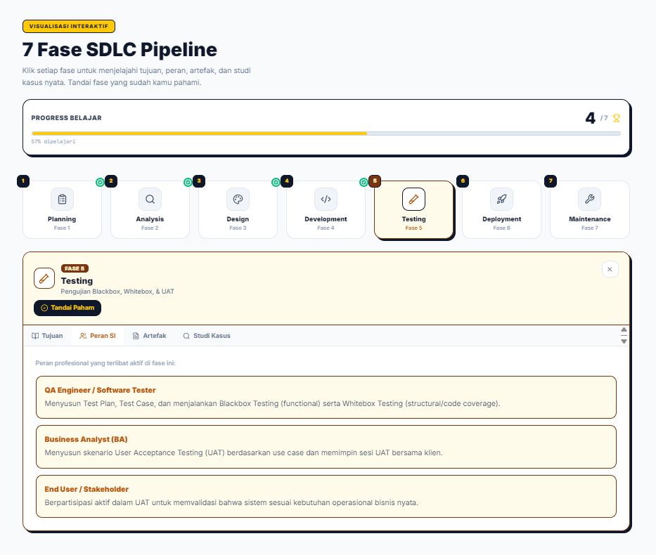
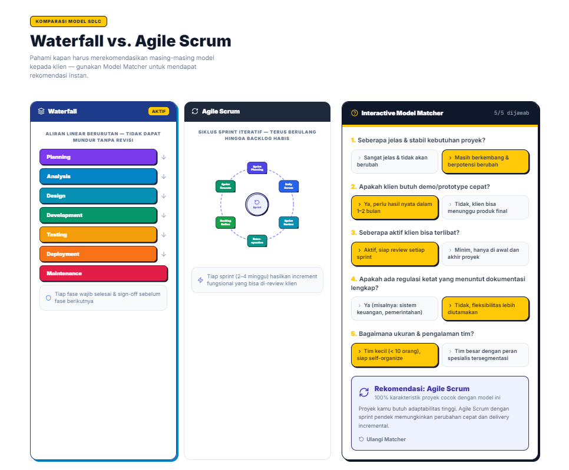
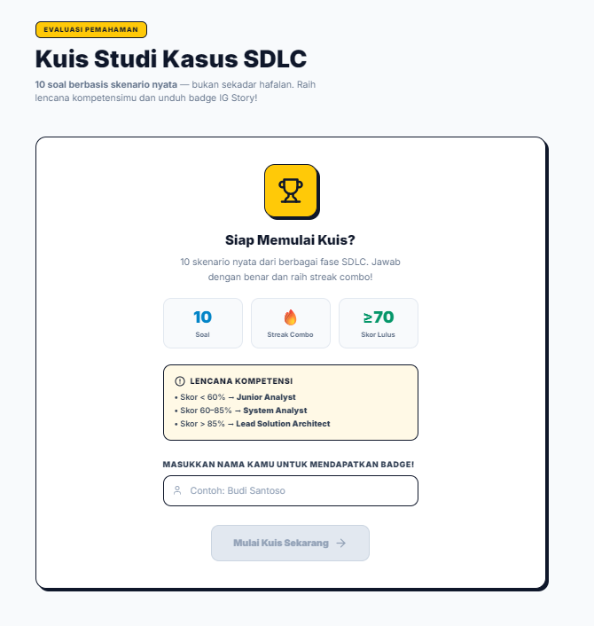
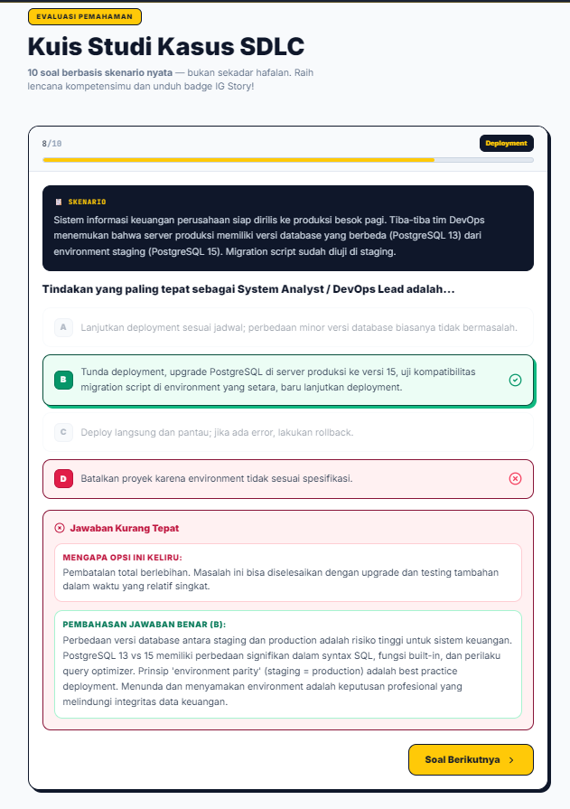

# ⚡ SDLCraft — Interactive SDLC Explorer

<div align="center">

```
  ____  ____  _      ____                 __  _   
 / ___||  _ \| |    / ___|_ __ __ _ / _| / /_(_)  
 \___ \| | | | |   | |   | '__/ _` | |_ | '_ \ |  
  ___) | |_| | |___| |___| | | (_| |  _|| (_) | |  
 |____/|____/|_____|\____|_|  \__,_|_|   \___/|_|  
                                                  
```

**Platform Edukasi Interaktif Siklus Rekayasa Perangkat Lunak Modern untuk Siapapun.**  
*Eksplorasi visual 7 fase SDLC, simulator rekomendasi model, evaluasi pemahaman studi kasus, dan lencana kompetensi digital berformat Instagram Story.*

---

[](https://reactjs.org/)
[](https://www.typescriptlang.org/)
[](https://tailwindcss.com/)
[](https://www.framer.com/motion/)
[](LICENSE)

</div>

---

## 🚀 Sekilas Platform

**SDLCraft** adalah platform web edukasi interaktif yang dirancang untuk menjembatani jurang antara teori akademis siklus pengembangan perangkat lunak (*Software Development Life Cycle* / SDLC) dengan realitas eksekusi di industri teknologi modern.

Dibangun dengan arsitektur modern (React 18, TypeScript, Tailwind CSS, dan Framer Motion), platform ini menolak metode belajar hafalan pasif. Setiap pengguna diajak untuk:
1. **Menjelajahi** 7 fase SDLC dalam kanvas interaktif dan mencatat kemajuan belajar secara mandiri.
2. **Mensimulasikan** pemilihan model pengembangan (*Waterfall* vs *Agile Scrum*) lewat *decision matrix* diagnostik.
3. **Menguji Logika** melalui 10 soal studi kasus skenario industri riil dengan instant feedback analitis.
4. **Mengklaim Lencana Kompetensi** yang bisa dibagikan melalui Instagram Story (rasio 9:16).

---

## 🎯 Untuk Siapa Platform Ini?

Platform ini dibangun dengan prinsip inklusivitas sehingga relevan dan ramah untuk **siapapun** yang ingin memahami bagaimana perangkat lunak skala produksi dibangun dari nol:

| Profil Pengguna | Manfaat Utama yang Diperoleh |
|---|---|
| 🎓 **Pelajar & Mahasiswa** | Memahami esensi rekayasa perangkat lunak tanpa hafalan buku tebal, lengkap dengan artefak riil (SRS, ERD, DFD, UAT, CI/CD). |
| 🔄 **Tech Career Shifters** | Mempelajari cara kerja tim teknologi, pembagian tanggung jawab peran, dan alur rilis aplikasi dari kacamata praktis industri. |
| 💼 **Junior Tech Professionals** | Business Analyst, QA, Product Owner, dan Junior Dev yang ingin memahami *the big picture* dari siklus pengiriman perangkat lunak. |
| 💡 **Tech Enthusiasts & Umum** | Siapapun yang penasaran dengan proses di balik layar pembuatan produk digital yang dipakai jutaan orang setiap hari. |

---

## 🎨 Sistem Desain & Palet Warna

```
┌────────────────────────────────────────────────────────────────────────┐
│  PALET WARNA RESMI SDLCRAFT                                            │
├───────────────────┬───────────────────┬────────────────────────────────┤
│ #FFC908           │ #0F172A           │ #F8FAFC                        │
│ Vibrant Yellow    │ Deep Charcoal     │ Crisp Clean Surface            │
│ (Brand & Aksen)   │ (Dark Container)  │ (Light Mode Background)        │
├───────────────────┼───────────────────┼────────────────────────────────┤
│ #0284C7 (Sky)     │ #10B981 (Emerald) │ #F97316 (Coral Orange)         │
│ Status Analysis   │ Status Sukses     │ Status Alert / Streak          │
└───────────────────┴───────────────────┴────────────────────────────────┘
```

## ✨ Fitur Utama & Interaktivitas

### 1. 🗺️ Animated SDLC Roadmap & Milestone Tracker
Jelajahi alur lengkap rekayasa perangkat lunak melalui visual pipeline 7 fase dengan status tracker mandiri:

<p align="center">
  
</p>

```
[1. Planning] ──▶ [2. Analysis] ──▶ [3. Design] ──▶ [4. Development] ──▶ [5. Testing] ──▶ [6. Deployment] ──▶ [7. Maintenance]
      ▲                 ▲               ▲                 ▲                  ▲                 ▲                  ▲
   Charter &         SRS & Use       ERD & UI        Clean Code &       Test Plan &       CI/CD Parity &     Hotfix, SLA &
  Feasibility          Cases         Mockups            CI/CD            Bug Triage         Rollback         Monitoring
```

- **Interactive Progress Tracker**: Tombol *"Tandai Paham"* di setiap detail fase yang memicu penghitungan kemajuan belajar real-time (`X/7 Fase`) disertai efek chime audio.
- **Panel Detail Komprehensif per Fase**:
  - **Tujuan Utama (Objective)** fase.
  - **Peran Profesional Industri** yang bertanggung jawab (BA, SA, PO, QA, DevOps, DBA).
  - **Artefak Input & Output** standar industri (Project Charter, SRS, SDD, ERD, Test Scenario, Migration Script).
  - **Studi Kasus Kontekstual** (SIMRS, E-Kampus, Fintech Payment Gateway, E-Commerce).

<details>
<summary><b>🔍 Klik untuk Melihat Ringkasan 7 Fase SDLC</b></summary>

| No | Fase | Output Kunci | Contoh Studi Kasus |
|---|---|---|---|
| 1 | **Planning** | Project Charter, Feasibility Study, WBS | SIMRS RSU Medika Nusantara |
| 2 | **Analysis** | SRS, Use Case, Activity Diagram | Sistem Registrasi Mahasiswa (E-Kampus) |
| 3 | **Design** | SDD, ERD, Arsitektur Microservices, Wireframe | E-Commerce Marketplace Flash Sale |
| 4 | **Development** | Source Code, Unit Testing, CI/CD Pipeline | Core Banking API Gateway |
| 5 | **Testing** | Test Matrix, Bug Reports, UAT Sign-off | Fintech Payment Integrator |
| 6 | **Deployment** | Release Notes, Data Migration, Parity Staging | Sistem Logistik & Tracking Nasional |
| 7 | **Maintenance** | Incident Log, Change Request, SLA Metric | Sistem Billing Listrik Pintar |

</details>

---

### 2. 📊 Interactive Model Matcher: Waterfall vs Agile

<p align="center">
  
</p>

Bukan hanya tabel statis, fitur ini menyajikan dua mode komparasi:
1. **Visual Pipeline Flow**: Animasi aliran sekuensial linear *Waterfall* berdampingan dengan radar sprint iteratif 6-tahap *Agile Scrum* (Sprint Planning, Daily Scrum, Sprint Review, Retrospective, Backlog Refinement, Sprint Execution).
2. **Interactive Model Matcher (Decision Engine)**:
   - Pengguna menjawab 5 parameter karakteristik proyek (Stabilitas Kebutuhan, Urgensi Demo/Prototype, Keterlibatan Klien, Kepatuhan Regulasi/Dokumentasi, serta Skala Tim).
   - Sistem secara cerdas menghitung persentase kecocokan dan merekomendasikan apakah proyek sebaiknya dieksekusi dengan model **Waterfall** atau **Agile Scrum**.

<details>
<summary><b>⚖️ Klik untuk Melihat 8 Kriteria Matriks Komparasi</b></summary>

| Kriteria Evaluasi | Waterfall Model | Agile Scrum |
|---|---|---|
| **Fleksibilitas Perubahan** | ❌ Sangat mahal di fase lanjut | ✅ Fleksibel di setiap sprint |
| **Kejelasan Kebutuhan Awal** | ✅ Wajib lengkap & final | ✅ Dapat berkembang bertahap |
| **Keterlibatan Klien** | ❌ Dominan di awal & akhir | ✅ Aktif setiap sprint review |
| **Waktu Rilis Produk Pertama** | ❌ Lama (akhir siklus) | ✅ Cepat (tiap 2–4 minggu) |
| **Kelengkapan Dokumentasi** | ✅ Sangat detail untuk audit | ❌ Fokus pada *working software* |
| **Prediktabilitas Biaya** | ✅ Terkunci sejak awal | ❌ Berubah mengikuti backlog |
| **Deteksi Risiko Teknis** | ❌ Baru terlihat saat testing akhir | ✅ Terdeteksi dini per sprint |
| **Karakteristik Tim** | ✅ Tim besar tersegmentasi | ✅ Tim kecil mandiri (5–9 orang) |

</details>

---

### 3. 🎯 Modul Evaluasi Pemahaman, Kuis Studi Kasus & Lencana Digital

<p align="center">
  
</p>

<p align="center">
  
</p>

Fitur kuis dirancang khusus untuk mengasah kemampuan *problem-solving* di lingkungan industri:
- **Input Nama Peserta**: Formulir nama di layar awal dengan validasi ketat, tersimpan otomatis di `localStorage` agar tidak hilang jika halaman disegarkan.
- **10 Soal Berbasis Kasus Riil**: Mengangkat dilema nyata di industri (paritas database Staging vs Production, negosiasi scope creep, prioritisasi bug kritis saat rilis, audit kelayakan finansial).
- **Instant Evaluasi Pemahaman (Real-Time Feedback)**:
  - ❌ **"Mengapa Opsi Ini Keliru"**: Membedah kesalahan logika dari opsi yang dipilih pengguna.
  - ✅ **"Pembahasan Jawaban Benar"**: Menguraikan dasar arsitektural dan praktik terbaik rekayasa perangkat lunak.
- **Fitur Review Pembahasan Menyeluruh**:
  - Layar ulasan khusus pasca-kuis untuk membaca kembali seluruh 10 soal dari awal hingga akhir lengkap dengan komparasi pilihan user vs kunci jawaban.
- **Streak Combo Multiplier**: Merayakan akurasi beruntun dengan badge interaktif (🔥 3x Streak!, 5x Streak Legendaris!).
- **Tingkatan Lencana Kompetensi**:
  - Skor < 60% → 🥉 `Junior Analyst` *(Perlu penguatan konsep dasar)*
  - Skor 60–85% → 🥈 `System Analyst` *(Pemahaman alur matang)*
  - Skor > 85% → 🥇 `Lead Solution Architect` *(Penguasaan arsitektur tingkat tinggi)*
- **🎉 Confetti Celebration**: Hujan confetti dinamis via Canvas Confetti untuk skor kelulusan (≥ 70%).

---

### 4. 📸 Fitur Download Lencana Instagram Story (PNG 9:16)

Pengguna dapat mendownload dan memamerkan pencapaian mereka ke media sosial melalui satu klik:
- **Resolusi Asli HD 1080 x 1920 Piksel**: Dihasilkan menggunakan HTML5 Canvas 2D API murni tanpa dependensi library eksternal yang rentan merusak CSS layout.
- **Komposisi Desain Story**:
  - Badge frame modern Yellow & Dark Tech.
  - Medali heksagon beranimasi skor persentase.
  - Nama pengguna terformat kapital tebal dengan auto-wrap otomatis.
  - Tanggal pencapaian resmi berformat lokal Indonesia.
  - **Kotak Tantangan Media Sosial**: Headline *"🔥 TANTANG TEMANMU! Aku berhasil menyelesaikan Studi Kasus SDLC. Bisakah kamu mengalahkan skorku?"*.

---

### 5. 🔊 Web Audio API Synthesizer
Platform ini dilengkapi sistem efek suara sintetis murni (tanpa memerlukan file MP3/WAV eksternal):
- Nada **Pop** saat memilih opsi kuis.
- Akord harmonik **Chime & Correct** saat menjawab benar atau menandai fase SDLC.
- Nada **Wrong** saat jawaban keliru.
- Nada arpeggio **Streak** saat mencapai 3 jawaban benar berturut-turut.
- Tombol **Mute/Unmute** audio global di bilah navigasi atas.

---

## 🛠️ Arsitektur Teknologi & Tech Stack

```
   ┌──────────────────────────────────────────────────────────────┐
   │                     SDLCraft Web App                         │
   ├──────────────────────────────┬───────────────────────────────┤
   │  Presentation Layer          │  Business & Interactive Logic │
   │  • React 18 (Functional/TS)  │  • Decision Matcher Algorithm │
   │  • Tailwind CSS 3.4          │  • Pure HTML5 Canvas 2D Export│
   │  • Framer Motion 11          │  • Web Audio API Synthesizer  │
   │  • Lucide React Icons        │  • LocalStorage State Cache   │
   ├──────────────────────────────┴───────────────────────────────┤
   │  Tooling & Runtime                                           │
   │  • Vite 5 (Bundler & Dev Server) • TypeScript 5.2 (Strict)   │
   └──────────────────────────────────────────────────────────────┘
```

| Modul | Teknologi | Peran Teknis |
|---|---|---|
| **Core UI Engine** | React 18.2 | Declarative component hierarchy & virtual DOM rendering |
| **Type Safety** | TypeScript 5.2 | Strict interface contract untuk data SDLC, kuis, dan audio context |
| **Styling Architecture** | Tailwind CSS 3.4 | Utility-first tokenisasi tema Hacktiv8 (`brand-yellow`, `brand-dark`, `shadow-neo`) |
| **Animation Physics** | Framer Motion 11.0 | Micro-interactions, spring transitions, AnimatePresence transitions |
| **Vector Icons** | Lucide React | Ikonografi SVG clean & scalable |
| **Celebration FX** | Canvas-Confetti 1.9 | Particle emitter efek selebrasi kelulusan skor kuis |
| **Social Card Export** | HTML5 Canvas 2D | Render canvas 1080x1920px untuk download instan PNG |
| **Audio Synthesis** | Native Web Audio API | Zero-latency oscillator synthesizer (sine/sawtooth waves) |

---

## 📁 Struktur Repositori

```
SDLCraft/
├── public/
│   └── favicon.svg              # Ikon topi wisuda emas khas SDLCraft
├── src/
│   ├── components/
│   │   ├── ModelComparison.tsx  # Pipeline Waterfall, siklus Agile & Interactive Matcher
│   │   ├── QuizSection.tsx      # Kuis 10 kasus, input nama, evaluasi, review, & IG Story
│   │   └── SdlcRoadmap.tsx      # Visual 7 fase, stepper, checklist paham & tab detail
│   ├── data/
│   │   ├── quizData.ts          # Bank 10 studi kasus industri, opsi, & pembahasan
│   │   └── sdlcData.ts          # Metadata 7 fase, peran profesional, & artefak
│   ├── utils/
│   │   └── audio.ts             # Web Audio API context, oscillator generator, & sfx
│   ├── App.tsx                  # Navbar (audio toggle), Hero section, & Footer
│   ├── main.tsx                 # Root bootstrap React DOM
│   └── index.css                # Custom directives & high-contrast shadow tokens
├── index.html                   # HTML entry point dengan metadata viewport
├── package.json                 # Daftar dependensi & npm scripts
├── tailwind.config.js           # Konfigurasi custom colors, fonts & box shadows
├── tsconfig.json                # Pengaturan compiler TypeScript (strict mode)
└── vite.config.ts               # Konfigurasi bundler Vite React
```

---

## 🚀 Memulai Proyek (Getting Started)

### Prasyarat Sistem
- **Node.js**: versi 18.x atau 20.x LTS direkomendasikan
- **Package Manager**: `npm` versi 9+, `pnpm` versi 8+, atau `yarn`

### 1. Kloning & Pemasangan Dependensi

```bash
# Masuk ke folder proyek
cd SDLCraft

# Pasang dependensi
npm install
# atau jika memakai pnpm:
pnpm install
```

### 2. Menjalankan Server Pengembangan Lokal

```bash
npm run dev
```

Buka peramban di: **`http://localhost:5173`**

### 3. Membangun untuk Lingkungan Produksi

```bash
# Validasi tipe data TypeScript & kompilasi aset statis
npm run build

# Menjalankan preview hasil rilis produksi lokal
npm run preview
```

Output kompilasi produksi yang teroptimasi akan berada di direktori `dist/`.

---

## 💡 Topik Kasus Industri yang Disajikan

<details>
<summary><b>📚 Klik untuk Melihat Skenario Masalah di Kuis Evaluasi</b></summary>

1. **Fase Planning**: Studi Kelayakan & Project Charter saat menghadapi instruksi mulai coding sebelum analisa.
2. **Fase Planning**: Negosiasi ruang lingkup (Scope Management) untuk integrasi 5 vendor pihak ketiga secara mendadak.
3. **Fase Analysis**: Pemilihan teknik requirement gathering ketika stakeholder sibuk dan berlokasi di 5 zona waktu.
4. **Fase Analysis**: Validasi proses bisnis checkout e-commerce menggunakan Activity Diagram & Business Process Model.
5. **Fase Design**: Normalisasi database (3NF) vs denormalisasi demi performa sistem transaksi tinggi.
6. **Fase Design**: Pemilihan pola arsitektur Microservices vs Modular Monolith untuk startup tahap awal.
7. **Fase Development**: Strategi Code Review & branch protection policy saat mengejar deadline rilis ketat.
8. **Fase Testing**: Bug triage saat menemukan *severity high / priority low* mendekati tanggal go-live.
9. **Fase Deployment**: Penanganan disparitas database Staging (PostgreSQL 15) vs Production (PostgreSQL 13).
10. **Fase Maintenance**: Manajemen insiden & rollback plan saat server produksi mengalami lonjakan error 500.

</details>

---

## 👨‍💻 Peran Industri yang Dicakup
- 👔 **Business Analyst (BA)** — Menghubungkan kebutuhan bisnis dengan spesifikasi sistem teknis.
- 📐 **System Analyst (SA)** — Merancang arsitektur sistem, skema database, dan diagram UML.
- 🎯 **Product Owner (PO) / Project Manager (PM)** — Mengelola backlog, prioritas sprint, dan timeline rilis.
- 💻 **Software Engineer (Frontend / Backend / Fullstack)** — Menulis clean code, unit test, dan integrasi API.
- 🧪 **QA Engineer & UAT Tester** — Menyusun test scenario, bug tracking, dan memastikan kualitas software.
- 🚀 **DevOps & Site Reliability Engineer (SRE)** — Mengelola CI/CD pipeline, parity environment, dan server uptime.
- 🗄️ **Database Administrator (DBA)** — Optimasi query, migrasi skema data, dan integritas transaksi.

---

<div align="center">

Dibuat untuk menghadirkan pengalaman belajar rekayasa perangkat lunak yang interaktif, kontekstual, dan menyenangkan bagi **siapapun**.

</div>
